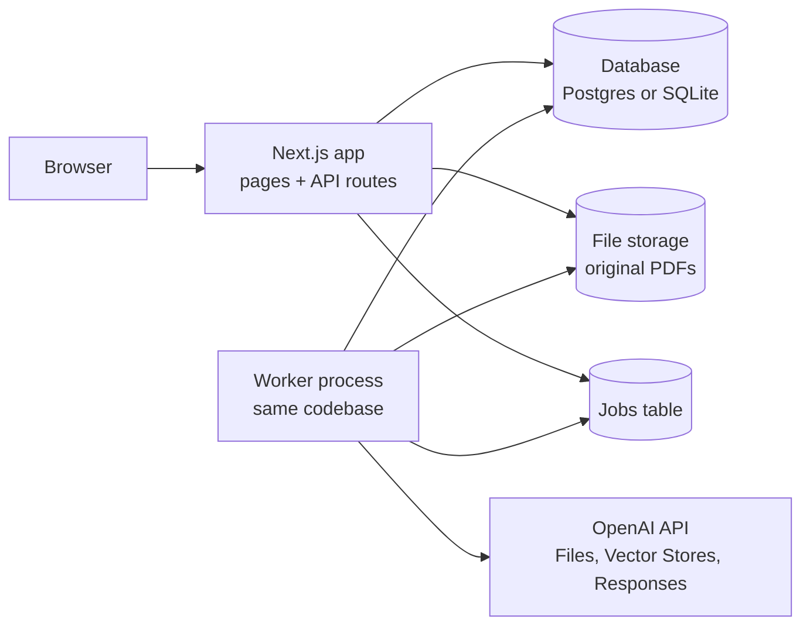
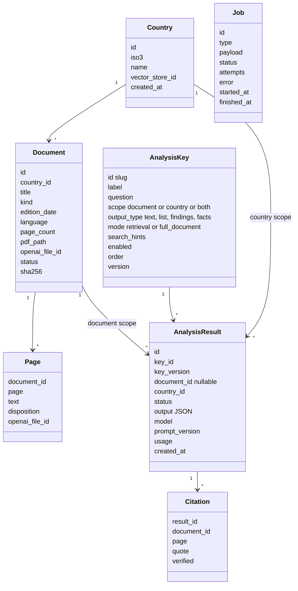

# Policy Tracker: project plan

Status: plan for implementation, 2026-10-18. Supersedes the pipeline in `fresh-start/PIPELINE.md`; keeps the rules in `fresh-start/GUIDE.md` where they still apply (see Part 8).

## 1. The product in one paragraph

A dashboard. You create a country, upload its policy documents (NDCs, adaptation plans, disaster-risk strategies), and the system analyses each document against a list of analysis keys and shows the results on the country page: one analysis per document per key, plus a country-level summary per key across its documents. Every answer carries quotes with page numbers so you can inspect it. The list of analysis keys is yours to edit in the dashboard: add a key, change its question, remove one. There is no human review step; quality comes from schema validation and automatic citation checks.

## 2. Definition of done

1. Create a country.
2. Upload two or more PDFs for it, with kind and edition date.
3. Wait for the status to reach "analysed" without touching anything.
4. Open the country page and inspect, per document and per key, the answer and its quotes. Open the country summary per key.
5. Add a new analysis key, remove an old one, and see the dashboard re-run only what changed.

## 3. Scope

In scope for version 1: countries, documents, editable analysis keys, document analysis, country summary, citations with page numbers, run status and cost, deletion that also cleans up OpenAI files, JSON export.

Out of scope for version 1: user accounts and permissions, human review workflows, scoring or grading, cross-country comparison pages (the data model allows it; the page comes later), OCR for scanned PDFs (pages without text are reported as unreadable), a chat box over the documents (cheap to add later with the same vector store; listed as optional).

## 4. Architecture



- **Web app:** Next.js (App Router, TypeScript). Pages for countries, a country, a document, analysis keys, runs. API routes for uploads and actions. Deployable on Vercel or a VM.
- **Worker:** the same codebase started as a second process (`npm run worker`). It takes jobs from a jobs table and runs them with a small concurrency limit. Jobs are idempotent and retried on failure. No external queue in version 1.
- **Database:** Prisma. SQLite for local use, Postgres for deployment. Holds countries, documents, page text, analysis keys, results, citations, jobs.
- **File storage:** a `storage/` folder locally, an S3-compatible bucket in deployment. Holds the original PDFs for viewing and download.
- **OpenAI:** the document layer and the model. One vector store per country. Each document is uploaded twice: the original PDF to the Files API (so a run can read the whole document when needed) and one plain-text file per page into the country's vector store, with attributes `country`, `document_id`, `page`, `kind`, `edition_date`. Analysis runs use the Responses API with structured JSON output and, in retrieval mode, the `file_search` tool filtered to one document.

Why per-page text files in the vector store: chunks of a PDF do not know their page number. A file per page does, through its attributes, so every citation gets a page without guesswork. Pages are 500 to 900 tokens, which is one chunk each; the default chunking settings are fine.

Why one vector store per country: isolation, simple deletion, and `file_search` scoped to the country by default. Per-document scoping is a filter on `document_id`.

## 5. Data model



Rules that matter:

- A result is tied to a key **version**. Editing a key's question or output type bumps the version; old results stay but show as stale until re-run. Removing a key soft-deletes it and hides its results.
- Page text is stored locally as well as in the vector store. It is what citation checks run against, and what the document page shows.
- Nothing is averaged, summed or scored. A result is an answer with evidence.

## 6. Analysis keys

A key is a question asked of every document, with a defined answer shape.

| Field | Meaning |
|---|---|
| `label` | Shown on cards, e.g. "Mitigation targets" |
| `question` | The instruction to the model, written as a question |
| `scope` | `document`, `country`, or `both` (country means a synthesis across the country's documents) |
| `output_type` | `text` (one answer), `list` (short items), `findings` (statements with a kind and numbers), `facts` (numeric targets and figures) |
| `mode` | `retrieval` (default: file search, top 20 pages) or `full_document` (the whole PDF as input; for keys that must be exhaustive) |
| `search_hints` | Extra phrases to retrieve with, e.g. "GHG, emissions, 2030, 2035, baseline" |

Output shapes (JSON schemas in the implementation plan):

- `text`: answer, confidence, citations.
- `list`: items, each with citations.
- `findings`: findings, each with text, a kind (`concern`, `commitment`, `planned_action`, `underway`, `delivered`, `other`), optional numbers, citations. The kinds are the response ladder from `fresh-start`, kept because "what did they do, how far" is the core question.
- `facts`: metric, value as stated, parsed value, unit, period, conditionality, citations.

Every output also has `not_found` (true when the pages read contain nothing on the question) and `note`.

Country scope: the input is the document-level results for the key, not the documents. The output has the same shape plus `by_document` and `changes_between_editions`. This is cheap and keeps the country summary consistent with the document answers.

Starter keys, seeded on first run and fully editable: document overview (text), key concerns and risks (findings), mitigation targets (facts), adaptation priorities and measures (findings), disaster risk management (findings), water and drought (findings), agriculture and food (findings), energy (findings), finance needs and sources (facts), implementation status (findings), barriers and support needs (list), groups addressed (list).

## 7. The analysis run

```mermaid
sequenceDiagram
  participant W as Worker
  participant DB as Database
  participant O as OpenAI
  W->>DB: take job "analyse document"
  W->>O: Files: upload PDF (once per document)
  W->>W: extract text per page (pdf-parse); mark empty pages unreadable
  W->>O: Vector store: add one text file per page with attributes
  W->>O: poll until all page files are indexed
  loop every enabled key with document scope
    W->>O: Responses: question + schema, file_search filtered to document (or whole PDF)
    O-->>W: JSON answer + citations
    W->>W: validate schema; check each quote against the page text
    W->>DB: save result, citations, usage
  end
  W->>DB: mark document analysed; enqueue country synthesis
```

Steps, in words:

1. **Ingest.** Save the PDF, compute its hash, upload it to OpenAI Files, extract text per page, write pages to the database, upload each page as a text file into the country's vector store with attributes, wait for indexing.
2. **Analyse per key.** Build the request: system text with the evidence rules (quote exactly, give the page, say not found when it is not there), the key's question, the output schema. In retrieval mode, attach `file_search` over the country's store filtered to this document, with the question and the search hints as queries and up to 20 results. In full-document mode, attach the PDF file as input instead. Ask for structured JSON.
3. **Verify.** Validate against the schema. For each citation, normalise whitespace and case and check that the quote occurs in the text of the cited page. Mark it verified or not. A finding with no verified citation is kept but flagged "unverified" in the UI. This replaces human review.
4. **Store.** Result, citations, token usage, model, key version, prompt version.
5. **Synthesise per country.** For each key with country scope, feed the document results in edition order and ask for the summary with `by_document` and `changes_between_editions`.
6. **Re-run on change.** New key: run it for every document and country. Edited key: bump version, re-run it. Removed key: hide. New document: ingest, run every key, re-run country syntheses.

Cost: one call per key per document, about 15k input tokens in retrieval mode. Twelve keys and four documents is about 50 calls per country plus 12 syntheses.

## 8. What carries over from fresh-start, and what does not

Carried over:

- The evidence rules: no quote, no finding; "not found" means not found in the pages read; unreadable pages are reported, never silently skipped.
- The response ladder (concern, commitment, planned action, underway, delivered) as the `kind` of a finding.
- Facts with value as stated, parsed value, unit, period and conditionality; never averaged.
- Config as data with versions: keys are rows, results record the key version and prompt version.
- Automatic checking as the quality gate; `fresh-start/scripts/check.py` is the model for the verification step.

Not carried over in version 1:

- The fixed 64-topic taxonomy. Keys replace it as the analysis dimension. The taxonomy stays available as a source for new keys.
- Stage-1 exhaustive extraction into records, topic packs, claims, stable claim IDs and the merge step. The per-key question-and-answer design is simpler, matches editable keys, and fits the vector store. If exhaustive coverage of a key proves necessary, `full_document` mode exists.
- The scoring layer. Nothing in the data model prevents adding scores per result later.

## 9. Dashboard pages

| Page | Shows | Actions |
|---|---|---|
| Countries | list with document counts and status | add country |
| Country | documents with status; tabs per document with one card per key; country summary section with one card per country-scope key; run status | upload document, re-run, delete |
| Document | one card per key: answer, citations with page, verified flag; page viewer; raw JSON toggle | re-run key, download PDF |
| Analysis keys | table: label, question, scope, type, mode, enabled, version | add, edit, remove, reorder, re-run affected |
| Runs | jobs with status, attempts, error, tokens, cost | retry, cancel |

## 10. Decisions

| # | Decision | Why | Watch |
|---|---|---|---|
| 1 | Per-key question answering over retrieval, not exhaustive extraction | Editable keys, cheap, fits the vector store | Retrieval can miss; `full_document` mode per key is the escape hatch |
| 2 | One vector store per country; one text file per page with attributes | Page numbers in citations; simple deletion | Many small files; fine up to thousands per store |
| 3 | Original PDF also uploaded to Files | Needed for `full_document` mode and the viewer | Two uploads per document |
| 4 | Results and app state in a relational database, not in the vector store | A vector store is for retrieval, not for records | The store can later hold result files for an "ask" feature |
| 5 | Worker as a second process on a jobs table | No queue service to run; good enough for one user | Move to a hosted queue if runs must scale out |
| 6 | Automatic citation verification instead of human review | The user asked for no review; a quote that is not on the page is the main failure | Unverified items are shown, not hidden |
| 7 | Key versioning with stale results | Editing a question must not silently mix old and new answers | Storage grows; prune old versions later |
| 8 | Next.js + Prisma + OpenAI Node SDK | Mainstream, one language, easy for the implementing agent | Python would be equally fine; not both |

## 11. Risks

- **Retrieval misses.** A key answered from 20 pages can miss a sentence on page 21. Mitigation: search hints, higher `max_num_results` for broad keys, `full_document` mode for exhaustive keys.
- **Hallucinated quotes.** Mitigation: verification against page text; unverified shown with a flag.
- **Scanned PDFs.** No text means no analysis. Mitigation: report unreadable pages clearly; add OCR later.
- **API drift.** OpenAI endpoint and parameter names change. Mitigation: the implementation plan lists what to verify against the current documentation before coding.
- **Cost surprises.** Mitigation: usage stored per result; a per-run cost shown on the runs page; a cap in configuration.
