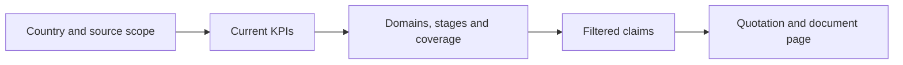

# Country and regional profile visualization plan

20 October 2026 · Proposal based on the active application, local source code and primary design guidance. No application changes are included.

**Revision:** Use the [final dashboard unification plan](dashboard-unification-final-plan-2026-10-20.md) as the implementation baseline. It incorporates the [intermediate dashboard strategy](unified-dashboard-strategy-2026-10-20.md) and the subsequent palette, naming, radar and scope decisions. Retain this document as the capability inventory and earlier design exploration.

Make the profiles explain **what the supplied policies address, what action stages they report, where documentation is missing, and which evidence supports each result**. Preserve the enabled KPIs and taxonomy. Build a small family of readable, connected charts rather than a separate climate monitoring product.

The recommended first release has three substantial visuals per overview: a domain comparison, a stage distribution and a coverage view. Regional comparison and country drill-down reuse the same components. Existing labels then support focused climate and disaster views within Claims and Targets.

## What is already available

### Observed application

The live regional overview showed three countries, six source documents, 721 claims, 464 action claims and 115 claims reporting implementation underway or output delivered. Its country entries showed 163 claim points for Belarus, 378 for Kazakhstan and 400 for Türkiye. These are observations of the selected reports on this date, not fixed test fixtures or claims about national performance.

The Kazakhstan main report showed 324 claims, 196 action claims and coverage of 61 of 64 topics. Its distribution was 128 non-action, 50 commitment, 115 planned, 26 underway and 5 delivered claims. The Targets screen showed 67 target-bearing claims, with structured filtering and source evidence. One claim can contain several target facts; 67 is not a count of distinct quantitative targets.

There are already graphics. The issue is their prominence, explanatory context and connection to the richer data:

| Surface | Present capability | Main opportunity |
|---|---|---|
| Country overview | Selected KPI, stacked claim/topic distribution, compact domain cards with bars, coverage and claim counts | Give domains an aligned comparison; keep volume, stage and breadth visible together |
| Regional overview | Country bars on a standardized scale, action-stage bars, list of topics without reported action | Prefer intelligible raw comparison first; show country-specific distributions and coverage |
| Compare | Domain rows × country columns, numerical colored cells, focused-domain comparison bars, mobile cards | Improve overview scanning, scale semantics and missing-state distinctions |
| Regional average and country Regional position | Raw comparison bars, mean reference, standardized values and source-profile filters | Explain the actual benchmark, cohort size and exclusions at the chart |
| Claims | Search, domain/topic/source/stage filters, eight label families, grouping, sorting, CSV, expandable evidence | Turn selected existing groupings into linked charts |
| Targets | Claims with structured target facts; quantitative, deliverable and qualitative categories | Summarize target-bearing claims by kind and domain before adding date or magnitude charts |
| Reported figures | Values, units, periods and conditions as stated; source links and CSV | Keep a source-oriented table until comparable numeric groups can be established |
| Documents | Document-date timeline, source/domain coverage and quotation-match information inside processing details | Make source scope easier to discover; keep processing information secondary |
| Reports | Saved country reports, selected main report and report-aware links | Carry report identity through every chart, evidence view and export |

The active stack is Next.js 16.4.2, React 19, Tailwind and existing HTML/CSS chart components. There is no dedicated charting library in `package.json`. Basic bars, matrices and distributions can be improved without adding one.

### Current KPI contract

The source code and active configuration take precedence where older documents disagree. In particular, the current default is **Claim points**; **Average action stage** is a separate metric.

| Enabled metric | Current meaning and denominator | Suitable visual | Interpretation to preserve |
|---|---|---|---|
| Claim points | Sum of resolved 0–4 progression points, once per grouped claim within the selected scope | Zero-based horizontal bars; raw number | Combines evidence volume and stated stage. Has no fixed upper bound |
| Average action stage | Within each topic, average distinct source-matched action-claim stages × 25; country/domain value is an equal-weight mean of scored home topics | Dot plot on a fixed 0–100 axis; scored-topic count alongside | No-action topics are excluded, not assigned zero. Partial results are provisional averages |
| Claims | Distinct grouped statements, including non-action statements | Horizontal bars and exact counts | Evidence volume, not policy strength or number of independent programmes |
| Action claims | Groups with a member at a selected stage; default stages 1–4 | Horizontal bars or selected subset of all claims | Changing selected stages changes this count, not the scoring formula |
| Topic coverage | Topics with any extracted claim ÷ enabled home-topic inventory | Coverage bar with numerator/denominator; domain matrix | Includes concerns and context; measures documented breadth |

Action coverage also exists as a derived metric in code, although it is absent from the five-option main metric menu. Use the existing topics-with-action count in a coverage breakdown; do not introduce another headline KPI.

The available regional transform is `100 × Φ((raw − mean) / population SD)`, version `regional-normal-cdf-v1`. The raw regional mean maps to 50. At least two complete, non-demo values are required; equal values map to 50 by convention. This is neither observed percentile rank nor percent implementation. Display/source-profile filters do not change the full-region standardization reference.

A country average can be high while few topics have action claims. Every prominent average-stage value must therefore show **scored topics / total topics**, plus coverage nearby. Claims and points across domains or topics may overlap and must never be summed into a country total.

### Enabled climate and disaster dimensions

All eight facet families are enabled in `config/labels.json`:

| Family | Useful view within the existing scope |
|---|---|
| Purpose | Adaptation, mitigation and disaster risk reduction claim counts |
| Hazards | Claims referring to drought, flood, heat, wildfire and other catalogued hazards |
| Risk function | Risk understanding, prevention/reduction, preparedness, anticipatory action, response and recovery |
| Risk component | Claims about hazard, exposure, vulnerability, capacity, impact and other existing components |
| Policy instruments | Plans, regulation, investment, information/warning, research/data and other existing instruments |
| Geographic scope | National, subnational, transboundary and other existing scope labels |
| Affected groups | Which groups are explicitly mentioned in policy claims |
| Cross-cutting themes | Inclusion, capacity, nature-based solutions, cooperation and other existing themes |

These dimensions can overlap. A claim mentioning adaptation and disaster risk reduction belongs in both category counts, once within each category. Their percentages need not sum to 100. Empty labels are not proof that a policy ignores a hazard or population.

Facts additionally contain type, target kind, metric, value as stated, unit, period, baseline, comparator, direction, basis, conditionality and finance status. These fields enable careful exploration, but several remain text strings rather than chart-ready numerical or temporal values.

## Scope and decision framework

The primary audience is a policy analyst or programme colleague reviewing supplied national climate and disaster documents. The default view should also be understandable to someone who has not learned the scoring method.

Use this repeatable specification for every chart:

**Reader question → existing measure → eligible records and denominator → encoding → source context → evidence action → accessible equivalent.**

For example: “Which domains contain more reported action?” → selected action-claim count → distinct groups in each home-domain scope → aligned horizontal bars → selected stages and report shown → click Water to open the matching claims → identical table and CSV.

| Reader task | Visualization response |
|---|---|
| Understand a country's documented policy profile | Domain bars, action stages, topic coverage |
| Compare countries fairly | Same metric, same scale, visible report/source scope and eligible cohort |
| Locate documentation needing review | Separate context-only, assessed-without-action and unassessed topics |
| Understand climate/disaster emphasis | Existing purpose, hazard and risk-function labels |
| Inspect a target | Type, stated value, period, baseline, conditions and original evidence |
| Verify a conclusion | Direct path from chart mark to claim, quotation and PDF page |

Keep the existing 16 domains and 64 home topics for the current inventory; derive counts dynamically from the report taxonomy rather than hardcoding 64.

Do not add hazard-intensity maps, emissions inventories, mortality/loss dashboards, exposure estimates, resilience indices, policy-quality ratings, cost-benefit scores or forecasts. Do not infer Sendai/SDG compliance from topic tags. UNDRR's monitor uses explicit reported indicators for losses, strategies and early-warning coverage; our policy-document KPIs cannot substitute for those indicators. [UNDRR monitoring context](https://www.undrr.org/implementing-sendai-framework/monitoring-sendai-framework/sfm-data-and-analytics).

Earthquakes and technological hazards remain valid disaster-policy subjects. Their presence does not establish climate causation.

## Research translated into design decisions

These are design recommendations applied to this tracker, not claims that one study validates the complete interface.

| Primary source | Relevant guidance or finding | Application here |
|---|---|---|
| [ONS visualization principles](https://service-manual.ons.gov.uk/data-visualisation/guidance/principles) | Organize charts around the important comparison; simplify and retain necessary context; check understanding with unfamiliar readers | One question per chart; three main overview visuals; evidence and methods available on demand |
| [Heer and Bostock, CHI 2010](https://hci.stanford.edu/publications/2010/crowd-perception/heer-chi2010.pdf) | Their graphical-perception experiments found common-scale position more accurate than several alternative encodings | Prefer aligned bars and dots for domain/country comparisons; no radar chart or bubble-size comparison as the default |
| [ONS axes and gridlines](https://service-manual.ons.gov.uk/data-visualisation/guidance/axes-and-gridlines) | Bars start at zero; comparable charts should share scales | Fix coverage and stage axes at 0–100; counts share a clearly stated scale within a comparison |
| [ONS chart colors](https://service-manual.ons.gov.uk/data-visualisation/colours/using-colours-in-charts) | Use few colors, consistent category meanings and restrained highlighting | Neutral surroundings; one highlight for a selected country; separate stage, quantity and deviation color roles |
| [W3C complex-image guidance](https://www.w3.org/WAI/tutorials/images/complex/) | A chart needs a short identification and an equivalent description of its essential information | Each chart includes a brief summary and a structured data table; tooltip text alone is insufficient |
| [W3C text contrast](https://www.w3.org/WAI/WCAG22/Understanding/contrast-minimum.html), [non-text contrast](https://www.w3.org/WAI/WCAG22/Understanding/non-text-contrast.html), [target sizes](https://www.w3.org/WAI/WCAG22/Understanding/target-size-minimum.html) | Contrast and operable controls are required parts of access | Validate light/dark themes, keyboard operation, chart boundaries and touch targets |

The existing UN-inspired blue is suitable as a continuity choice. A palette's institutional origin does not make the tracker an official UN assessment or prove its accessibility.

## Country profile composition

Keep the existing routes and evidence views. Improve Overview rather than adding a new dashboard destination.

| Page order | Content | Design behavior |
|---|---|---|
| 1 | Country, selected report, source-document count and edition range, assessment status | Compact source strip; details expand; historical-report identity remains visible |
| 2 | Current selected KPI, claims, action claims and topic coverage | Keep Claim points as the initial selection; make Average action stage easy to select; display units explicitly |
| 3 | Domain comparison | Main full-width visual with aligned labels and shared scale |
| 4 | Reported stages and topic coverage | Two complementary charts beside each other on wide screens, stacked on mobile |
| 5 | Evidence needing review | Short list with counts and explicit status; “View all” opens the complete inventory |
| 6 | Climate and disaster exploration | A compact entry to purpose/hazard/risk-function views in Claims, avoiding eight charts on Overview |

Recommended reading sequence:

### Country chart specifications

| ID | Reader question and encoding | Data and interaction | Empty/provisional handling |
|---|---|---|---|
| C1 Domain comparison | “How does documentation vary by domain?” Horizontal bars for counts/points; dots for average stage; coverage bars for coverage | Existing domain summaries; default taxonomy order, optional metric sort; show all 16 domains; row opens existing domain/topic evidence | Preserve zero as zero only when known. Unavailable has no numeric mark. Show provisional label beside observed values |
| C2 Claim-stage distribution | “What stages do the supplied documents report?” Aligned category bars with count and share; a compact stacked strip may remain as a summary | Distinct country groups; non-action, commitment, planned, underway, delivered and unresolved as applicable; label denominator “all claims”; click category to inspect claims | Preserve mixed/unresolved groups explicitly. Do not assign their highest member stage |
| C3 Topic coverage | “How much of the topic inventory is documented?” Separate observed presence from assessment completion | Main partition: action found, other claims only, no claims observed. Completion/status row distinguishes assessed absence from unresolved processing. Every segment opens the corresponding topics | “No claims observed” during partial processing is not “no evidence after assessment.” No invented confidence intervals |
| C4 Country relative to region | “How does this country's documented value compare?” Horizontal country dots/bars with a mean marker | Reuse Regional position; selected country highlighted; all peer values and eligible N shown; raw first, standardized optional | Fewer than two eligible countries: own value may display, benchmark unavailable. Partial own value is not placed in the eligible cohort |
| C5 Climate and disaster lens | “Which hazards or purposes do policy claims address?” One selected facet shown as horizontal bars | Reuse grouped searchable claims and their label filters; purpose, hazards and risk function are quick choices; all enabled facets remain available | Show classified/partial/unavailable record counts. “No label recorded” is distinct from “zero eligible claims” |

C2 must not become a funnel or connected progression diagram. The stage categories do not track the same interventions moving through time.

For C3, keep the current topic-coverage KPI unchanged. Its visual partition requires a small deterministic adapter that combines observed presence with processing state. A safe presentation uses two aligned rows, so a topic can show observed action while its processing remains incomplete.

## Regional profile composition

Keep Overview and Compare as the main routes. Put the current corpus and benchmark size near the charts. With three countries, all three should remain visible; elaborate mapping or clustering would add little.

| ID | Reader question and encoding | Data and interaction | Interpretation |
|---|---|---|---|
| R1 Country comparison | “How do the selected values differ?” Horizontal bars for claim points/counts; dots for average stage; same axis for every country | Existing country metrics and reference functions; raw default proposed; retain the standardized switch and current formulas | Show source counts and eligible N. The corpus is the tracker’s country set, not necessarily a representative geographic region |
| R2 Domain matrix | “Which domains account for the pattern?” Preserve domain rows × country columns with exact values and restrained color | Existing matrix; domain selection reveals aligned country bars and evidence links; compact table alternative | Raw intensity compares quantities. Relative coloring, when selected, must explicitly name the per-domain regional reference |
| R3 Stage composition by country | “Are documents mainly stating commitments, plans or implementation?” One 100% stacked bar per country, with category values in an adjacent table | Same grouping and category rules as C2; country total and action count shown; optional absolute-count view | Country bars each total 100%; this does not make their evidence volumes equal |
| R4 Documentation gaps | “Where is further evidence review useful?” Topic rows with counts of countries in each evidence/status category | Reuse home-topic inventory; action present, other claims only, assessed absence, processing incomplete shown separately; expand to countries | Do not count unfinished topics as confirmed gaps. Show country–topic pairs separately from distinct topic count |
| R5 Climate/disaster comparison | “How do documented hazards or risk functions differ?” Facet × country numeric matrix or small bar charts | Use the selected enabled facet and distinct claims; count by default, optionally share of eligible claims with denominator shown | Multiple labels overlap. This measures documentary emphasis, not hazard prevalence or people protected |

Overview should initially show R1, R3 and a concise coverage/gap summary. R2 stays in Compare. R5 belongs in the analytical Claims view. This limits the number of visuals competing for attention.

When aggregating regionally, distinguish **pooled claim counts**, **equal-country benchmark means**, and **country–topic observations**. They answer different questions. Never give all three the generic label “regional score.”

## Targets and reported figures

Start with two useful summaries that need no new extraction: target-bearing claim counts by domain and counts by target kind. Retain the full source-linked list below them. Kind counts can overlap when a claim contains several target kinds; use separate bars, not a pie claiming mutually exclusive parts.

Subsequent charts require explicit eligibility rules:

| Proposed view | Required data | Boundary |
|---|---|---|
| Target deadline distribution | Structured target fact with an unambiguous deadline or interval in its stated period | Keep dates not stated, ambiguous dates and intervals visible. Do not treat every year mentioned as a deadline |
| Deadline agenda | Same qualified facts, grouped into readable date buckets | “Stated deadline passed” does not mean “missed target”; no completion assertion without evidence |
| Comparable target magnitudes | Same metric definition, unit, geography, period, baseline/basis, comparator, direction and conditionality | Keep incompatible groups separate; never add percentages, hectares, currency and capacities |
| Target versus reported observation | Explicitly compatible target and observed value, including baseline, scope and reference date | Deferred until a reliable pairing contract exists; matching prose or unit strings is insufficient |
| Finance view | Compatible amounts, currency and price basis, period, finance status and scope | Do not sum needs, pledged budgets, allocations and expenditures together |

For dates, expose parser results and rejection reasons in the adapter; retain source text. This is a data-preparation task within the existing facts, not permission to infer missing deadlines with a model.

For Reported figures, the table remains the default. A mixed set of extracted numbers is not automatically a numerical series.

## Visualization design parameters

The values below are initial design specifications to test, not externally validated measurements of this app.

| Parameter | Proposed rule |
|---|---|
| Information hierarchy | Scope first, headline numbers second, one dominant comparison third, supporting composition/coverage next, evidence on demand |
| Visual density | Three main overview visuals; one active facet chart in exploration; no decorative empty panels |
| Layout | Use available content width; approximately 24px section gaps and 16–24px panel padding; align chart plotting areas rather than centering unrelated cards |
| Typography | Existing system typography; 14–16px chart labels, 12–14px supporting text, 28–36px KPI numbers; tabular numerals; long domain labels wrap |
| Bar geometry | Approximately 12–18px marks in 36–44px rows; square or modestly rounded ends; no 3D, gradients implying extra precision or decorative shadows |
| Scales | Bars start at zero. Stage and coverage use 0–100. Counts/points use a shared 0–maximum scale within the comparison, with endpoints visible |
| Precision | Counts and points remain integers; headlines retain existing whole-number /100 formatting; details may show one decimal. Band membership uses unrounded values |
| Ordering | Taxonomy order for learning the country profile; optional value sort with stable tie handling; stage order fixed from non-action through delivered |
| Color roles | Blue for navigation/selection; one hue for raw quantities; ordered stage colors; a separate diverging scale for below/above regional reference; neutral missing states |
| Existing palette | Preserve current stage meaning during the first prototype. Evaluate a neutral non-action treatment and accessible sequential stage palette separately; do not silently redefine stages or thresholds |
| Comparison colors | The current red–yellow–green palette uses the same colors for stages and SD position. Separate these visual meanings in the proposed design; “below average” must not visually imply policy failure |
| Legends | Short and adjacent; labels and values directly on or beside marks; full methods in an expandable area |
| Text | Chart title states the question/measure; subtitle states scope and denominator. Use “reported,” “documented” and “source matched” precisely |
| Benchmark | Marker label states mean, eligible N and source scope. Distinguish the optional source-matched subgroup average from the full-region standardized reference |
| Interaction | Click/tap/Enter opens a defined evidence view. Hover is optional. Show selected filters and a clear reset; preserve browser Back and selected report |
| Filtering | Display selection does not silently change a score denominator or normalization cohort. Stage selection changes only action counts. Exploration filters get explicitly filtered counts |
| Missingness | Distinct states for zero, assessed no action, no claims observed, pending, failed, partial, unlabeled, mixed/unresolved and demo |
| Small samples | Always display N; three-country comparison remains descriptive. No bell curve, percentile-rank claim, significance language or confidence interval derived from processing incompleteness |
| Responsive behavior | Two columns become one; labels move above bars if necessary; matrices become readable domain sections or selected-domain comparisons rather than miniature cells |
| Accessibility | Keyboard-operable marks or equivalent links; visible focus; semantic headings/tables; short summary; no color-only or hover-only meaning |
| Contrast and targets | At least 4.5:1 for normal text, 3:1 for large text and necessary graphical/UI distinctions; aim for 44px control hit areas, while meeting WCAG 2.2's 24px minimum or applicable spacing exceptions |
| Motion | No animated counting or continuously moving charts. Respect reduced motion; transitions, if used, should help preserve selection context |
| Source context | Selected report, document editions, taxonomy/method version and classification completeness in details; report date is distinct from source edition and action period |
| Export | Same displayed rows, values, filters, units, denominator and method metadata in table/CSV; printable chart includes source scope and exclusions |
| Performance | Aggregate once from existing read models; send chart summaries rather than entire source PDFs to the client; avoid chart-triggered model calls |
| Growth | Three countries now; test more countries and long labels. Keep horizontal matrix scrolling contained; offer selection/search without concealing omitted countries |

Color and accessibility specifications follow the linked ONS and W3C guidance above. Spacing, font sizes, layout counts and the 44px preferred hit area are proposed product choices.

## Data enablement and implementation approach

### Reuse the existing calculation and evidence paths

| Existing file or area | Planned use |
|---|---|
| `src/lib/documentation-score.ts` | Country, domain and topic summaries; processing state and coverage |
| `src/lib/documentation-stage.ts` and `config/scoring/documentation.json` | Preserve average-stage calculation and its denominator |
| `src/lib/dashboard-metrics.ts` | Metric labels, selected action stages, shared scales and regional normalization |
| `src/lib/claim-score.ts` | Preserve unique-group point rules and unresolved/source-match flags |
| `src/lib/regional-dashboard.ts` | Regional summaries, stage counts and cohort information |
| `src/lib/claim-explorer.ts` and `src/lib/claim-view-state.ts` | Facet aggregation, evidence filters, stable claim identities and URL state |
| `src/components/charts/comparison-bars.tsx` | Extend aligned comparisons and their accessible value lists |
| `src/components/charts/distribution-summary.tsx` | Reuse compositions; add linked category exploration where meaningful |
| `src/components/charts/country-matrix.tsx` | Refine existing matrix and focused domain display |
| `src/components/charts/documentation-dashboard.tsx` | Country visual hierarchy and aligned domain view |
| `src/components/regional-dashboard.tsx` | Regional hierarchy and per-country compositions |
| `src/components/claim-explorer.tsx` | Optional facet chart above the existing evidence explorer |
| `src/components/regional-figures.tsx` | Retain source figures; add qualified comparisons only later |
| `src/lib/report-reader.ts`, `src/components/report-link.tsx` | Report fidelity through every drill-down |
| `src/app/globals.css` | Shared chart tokens and light/dark treatments |

Build a small typed chart-data adapter around these outputs. Each chart payload should identify its question, metric, unit, scope/report, rows, numerator/denominator where relevant, missing/provisional state, benchmark/cohort, source/method metadata and evidence destination. Do not recalculate score formulas inside chart components.

Facet adapters deduplicate by claim ID inside each category; country-wide totals use the existing grouped inventory, never the sum of label buckets. Target adapters distinguish claim counts from fact counts.

Use server-rendered HTML/CSS for bars and semantic tables, and SVG where dot markers or axes make it worthwhile. Limit client components to selection, filtering and interactive tooltips. The installed Next.js Server and Client Components guide was checked; it supports this server-first split. Reassess a chart library only if later requirements exceed these primitives.

### Issues to resolve before extending visuals

1. **Documentation drift.** README and portions of the dashboard guide contain older highest-stage scoring, provisional-minimum and target-availability descriptions. Reconcile product copy with the active code as part of implementation.
2. **Gap denominator.** The displayed regional 47 is a count of country–topic combinations, not unique topic IDs. The existing gap aggregation can also include unprocessed topics. Keep the observed count identifiable; derive confirmed gaps separately using processing state.
3. **Quotation match versus completeness.** Raw claim-point code can retain resolved points where source matching is incomplete, while average-stage scoring filters to source-matched actions. Show the available source-match status; do not quietly change the formula or claim that all points prove verified evidence.
4. **Classification availability.** All eight families are enabled, but this is not proof that every current or historical claim has complete labels. Measure the actual selected report before drawing facet charts.
5. **Cross-report comparisons.** Saved country reports and current peer reports may differ in editions or method/taxonomy versions. Show identities and compatibility; do not plot historical snapshots as a performance trend automatically.
6. **Multiple references.** A filtered source-profile mean and full-region standardized reference can differ. If both appear, label both rather than drawing a generic “average” line.

These are data/presentation gates. They do not authorize a new scoring rubric, extraction pipeline, OCR run, document rerun or paid model call.

## Delivery sequence

| Phase | Work | Exit condition |
|---|---|---|
| 0 Metric and scope contract | Record current formulas, source/report identity, all denominators and state rules; resolve copy inconsistencies and gap labeling | Every proposed visual maps to an enabled measure and reproducible existing records |
| 1 Country prototype | C1–C3, existing KPI strip, clear source/status row, keyboard and mobile layouts | A reader can distinguish volume, action stage and breadth, then open supporting evidence |
| 2 Regional prototype | R1–R4 using the same components; raw/standardized distinction; source cohort labels | Comparisons use consistent scales and eligible records; country–topic gaps and unknowns are distinct |
| 3 Climate and disaster exploration | C5/R5 with purpose, hazards and risk function as quick choices; target-kind/domain summaries | Each chart exactly matches its filtered unique-claim list and shows label availability |
| 4 Qualified temporal/numeric views | Audit existing periods and figure compatibility; add deadline/metric charts only for eligible groups | Every plotted date/value has explicit eligibility, provenance and an honest excluded/unknown count |
| 5 Release validation | Readability sessions, accessible tables/exports, mobile/dark-mode checks and appropriate code checks | Acceptance conditions below pass; unsupported views remain table-based |

The recommended first implementation scope is phases 0–2. Phase 3 provides the strongest next climate/disaster-specific value without expanding the KPI framework. Phase 4 is conditional on the data audit, not a promise that the current fields are sufficient.

## Acceptance criteria

| Area | Required check |
|---|---|
| Numerical fidelity | Chart values match the active metric adapter and corresponding evidence view. Country totals do not change because of a presentation-only edit |
| Score interpretation | Average stage shows scored/total topics; no-action topics remain outside its average; provisional average can rise or fall |
| Double counting | A cross-tagged claim counts once nationally and once per applicable category; overlapping rows are not added into an overall total |
| Stage fidelity | Mixed or unresolved groups retain that state; implementation-reported counts do not silently include all mixed groups containing an advanced member |
| Coverage and gaps | Complete absence and unfinished assessment render differently; the regional country–topic denominator is explicit |
| Regional math | Test fewer than two countries, equal values/zero SD, complete versus partial/demo, subgroup mean versus full reference and noncomparable report versions |
| Filtering and navigation | Every plotted mark reaches the correct country/domain/topic/stage/facet evidence with report ID preserved; Back restores a meaningful view |
| Data quality | Unmatched quotations, stale classification, absent labels, ambiguous periods and incompatible figures remain visible or are explicitly excluded |
| Accessibility | Complete essential tasks by keyboard; use a screen reader to reach summary and table; test without color; verify contrast in both themes |
| Layout | Check 360px mobile, tablet and desktop, 200% zoom, long labels, zero-length bars, one country and a larger country set |
| Export | Table/CSV numbers and categories match the displayed chart; scope, method and denominator travel with exported information |
| Performance | No new model calls or pipeline runs; compare profile load and filter response against the existing app on representative data |
| Comprehension | Ask 3–5 representative readers to identify the most documented domain, distinguish coverage from stage, locate an unassessed topic, explain the benchmark and open a source |

Suggested usability targets are a correct answer to the first three overview questions within roughly 30 seconds and a source quotation within two deliberate drill-down actions. These are proposed test goals, not measured current performance.

During implementation run the repository's typecheck, lint and relevant existing tests. Add tests only for new aggregation/eligibility behavior and regressions involving denominators, overlap and missingness. Do not create tests merely to assert decorative markup.

## Audit boundaries

This plan uses source/configuration inspection and live desktop inspection of the regional overview, Kazakhstan overview and Kazakhstan Targets. The regional Compare component and benchmark logic were inspected in source; a later live Compare navigation timed out. A read-only country JSON-export request also timed out, so this was not a full current-database or export audit. Mobile, screen-reader, contrast and performance checks are specified for implementation and have not been claimed as completed.

Only this proposal was added. Scoring, taxonomy, source records and application behavior were not changed.
