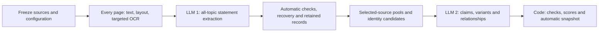

# Pipeline: complete source processing, traceable claims

20 October 2026 · **Final implementation plan, not active application behavior.** The [final upgrade plan](FINAL-UPGRADE-PLAN.md) controls this revision, incorporating the supplied pipeline handoff. Preserve taxonomy 3.0, [scoring 4.0](../ui-scoring/METHOD.md) and [dashboard presentation 4.1](../ui-scoring/README.md).

## The method in one minute

Use **two principal LLM stages**: extract source statements, then organize common claims. Code prepares documents, pools records, validates references, calculates scores and publishes. Conditional OCR, image interpretation, omission checks and repairs recover difficult material; they are not mandatory human review stages.

Process every selected source packet across all 64 topics. Search supports questions and discovery; it no longer determines which passages enter extraction. One run can cover a document, selected documents, a country or the whole collection, country by country. Keep historical editions, annexes, sectoral plans and supplements accessible.

## Step by step

| Step | Method | Example or boundary |
|---|---|---|
| 1. Freeze the run | Record selected document hashes, roles, editions, country, source-selection rules and configuration versions. | A later upload creates a newer manifest rather than changing dispatched work. |
| 2. Prepare every page | Preserve text, layout, physical pages, printed labels, tables, footnotes and image regions. Apply local OCR to scanned/garbled regions; use conditional vision where substantive meaning remains inaccessible. | Readable paragraphs do not establish that an adjacent chart was processed. Keep crops and transcription provenance. |
| 3. Build owned packets | Group natural source units with necessary headings, neighboring text and table context. Give each unit one extraction owner. | A continued table inherits headers and footnotes without duplicating ownership. |
| 4. Extract across all topics | LLM 1 returns statements, English titles, existing labels, facts and original-language evidence. Code derives domains from topic IDs. | Retain concerns and relevant unmapped assertions, even when unscored. |
| 5. Check and recover | Check schema, references, quotations, qualifiers, title grounding and unit accounting. Repair affected units; audit flagged packets and a stable sample. | Every unit has records, a justified no-relevant-assertion disposition, or unresolved status. Empty JSON is insufficient. |
| 6. Select and pool evidence | Preserve immutable records; prepare the explicit document/current/historical source scope and identity candidates. | Excluded editions cannot supply details to a current assessment. |
| 7. Organize common claims | LLM 2 groups the same proposition, preserves variants and links related assertions. Partition when necessary and reconcile boundaries. | Shared quotation, topic or programme name alone cannot establish identity. |
| 8. Calculate and publish | Code checks membership, calculates reviewed scores and publishes coherent snapshots automatically. | Grounded statements can publish while unresolved work keeps affected aggregate scores unavailable. |

## One proposition, with its details

“The ministry will rehabilitate 30 km of canals during 2026–2030” is one response with responsibility, timeframe and output attached. Do not create separate claims for the ministry, date and distance. “Existing irrigation serves 60,000 hectares” is separate context.

If an NDC specifies 100,000 hectares by 2030 and a NAP specifies 80,000 under comparable conditions, retain both as conflicting target variants. Link canal rehabilitation and capacity as related evidence; neither proves achievement. Different scopes, periods or conditional pathways are not automatically contradictions.

Generate readable titles inside the existing calls, grounded only in the statement or the claim's members and explicitly associated details. Related context cannot upgrade a title. Repair unsupported titles; meanwhile display the complete grounded statement. Titles never determine persistent identity.

## What each LLM receives

| Input | Extraction | Organization |
|---|---|---|
| Instructions | One extraction prompt | One organization prompt |
| Vocabulary | Concise full topic catalogue, routing and enabled labels | Relevant topics, existing labels and relationship rules |
| Evidence | Owned source units plus separately marked necessary context | Immutable records, exact evidence, facts and owned/context-only status |
| Metadata | Document identity, edition and source context | Selected-source metadata and prior identity candidates |
| Output | Strict schema: records, evidence, titles, field provenance and unit accounting | Strict schema: titles, variants, membership references, relationships and retained unresolved records |

A conditional recovery prompt receives original units, retained records and specific failures. It requests missing assertions or evidenced corrections, not a general opinion about answer quality. No stage reads operator guides, archives, scores, credentials or arbitrary folders. Source text and metadata remain untrusted data. Models do not invent URLs, calculate scores or certify completeness.

The [v3 machine files](../pipeline/pipeline.json), [prompts](../pipeline/prompts/extract.md), [contracts](../pipeline/llm-contracts.json) and [compiled examples](../examples/extraction-request.json) are preserved baseline references. **They are not the final requests for this plan.** Update the allowlisted bundle, builder, schemas and examples together; generate readable prompt documentation from that bundle.

## Source scope and history

Separate document kind from national/sectoral/subnational scope, edition family and supplement relationship. A sectoral NAP is useful evidence but does not silently satisfy a required national NAP role. Unknown classification remains explicit without blocking grounded statements.

Keep document-only, selected current-corpus and historical/all-supplied views. Preserve cross-edition identity lineage, but calculate each view from selected records. An NDC-only response cannot borrow a NAP actor. A later edition's silence does not establish withdrawal. Missing national documents and failed processing are separate gaps; neither becomes a zero-policy finding.

## Initial operating settings

These are tunable hypotheses, not established optima. Preflight the entire request using the chosen model's tokenization, including instructions, vocabulary, schema, context, reasoning/output reservation and safety margin.

| Setting | Initial value |
|---|---|
| Owned narrative / dense-table text | 4,000 / 2,000 tokens; natural boundaries |
| Prepared source plus context | Split near 8,000 tokens; retain necessary qualifications |
| Extraction output reservation | 16,000 tokens |
| Organization input | Target 12,000; split near 24,000 tokens |
| Organization output reservation | 12,000 tokens |
| Full-request safety margin | 10%, at least 2,000 tokens |
| Scheduling | One country; two shared model-request slots initially |
| Model candidates | Configurable Luna: low extraction, medium organization; stronger targeted recovery |
| Omission audit | Flagged packets plus stable 10% sample per document, minimum one if nonempty |
| Optional search index | 800-token chunks / 100 overlap; independent of extraction |

A material omission expands checks across that document, prioritizing affected layouts/languages. Cache checks against the exact extraction revision. Oversized outputs trigger subdivision immediately. Use one targeted repair and, when configured, one stronger attempt. Transport errors share bounded backoff—initially five attempts per dispatch episode—without multiplying SDK/job retry loops.

## Reliable completion without a review queue

Persist attempts, usage, leases, source-unit dispositions and record ownership. Resume compatible unfinished work without duplication. A corrupt file can leave one country partial while later countries continue; account-wide access/quota errors pause shared dispatch. There is no page, statement or whole-run completion cutoff. Explicit resource limits create visible resumable pauses.

Grounded statements may appear as provisional singletons when grouping fails. Evidence and individual checks remain inspectable; unfinished identity resolution prevents final unique-claim totals and comparative averages. Complete processing/accounting does not promise perfect semantic recall.

Publish atomically, retain prior snapshots and prevent stale runs overwriting newer ones. Reuse preparation/extraction when content and semantic configuration match; recalculate display/scoring changes from stored facts. A new extraction field or scope can require reprocessing affected units.

The interface retains Country → Domain → Topic → Claim → Evidence navigation, regional comparison and document-specific results. Flags and hide/restore act after publication. A display-only hide does not change shared scores; an analytical exclusion creates a new auditable assessment.
