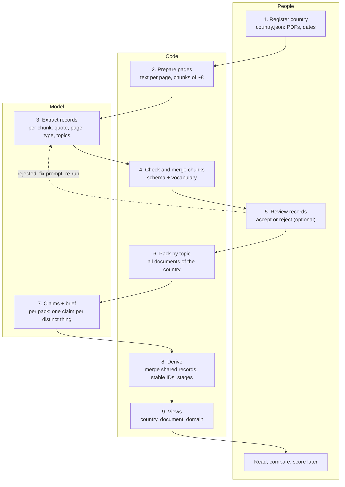
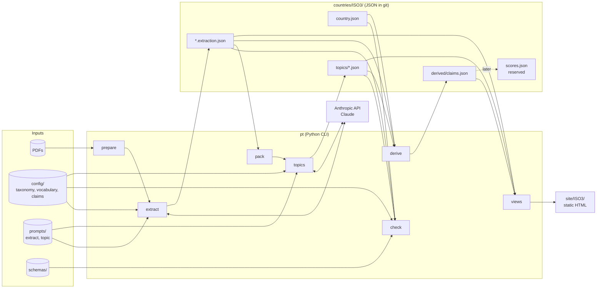
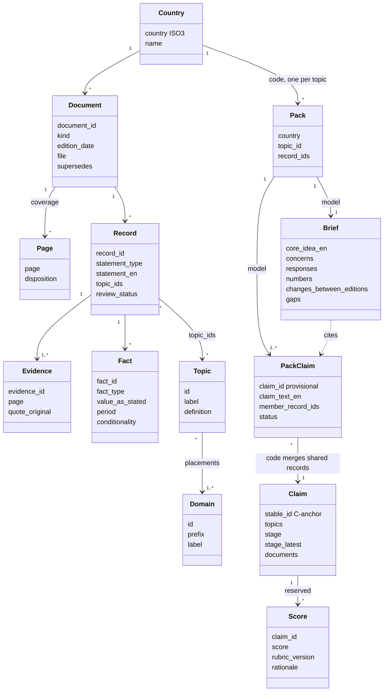

# Pipeline and architecture

Status: proposal, 2026-10-18, revision 2. The diagrams are Mermaid; GitHub renders them.

## 1. What runs where

The whole thing is one small Python command-line tool (working name `pt`), one subcommand per step, plus JSON files in git. The model is Claude, called through the official Anthropic Python SDK. There is no database and no server in the first version: a country is a folder, every step reads and writes files in it, and the views are static pages built from those files. A web app can come later and read the same files.

| Step | Command | Who | Reads | Writes |
|---|---|---|---|---|
| 1 Register | edit by hand | people | the PDFs | `countries/<ISO3>/country.json` |
| 2 Prepare | `pt prepare KAZ` | code | each PDF | `work/<doc>/pages.jsonl` (text per page), chunk list, unreadable pages |
| 3 Extract | `pt extract KAZ [doc]` | model, per chunk | chunk text + taxonomy + vocabulary + extract prompt | chunk outputs, merged by code into `<doc>.extraction.json` |
| 4 Check | `pt check KAZ` | code | everything in the folder | validation report; this is `scripts/check.py` |
| 5 Review | edit `review_status` (later a small form) | people | an extraction file | the same file |
| 6 Pack | `pt pack KAZ` | code | all extraction files | `work/packs/<topic>.json` |
| 7 Topics | `pt topics KAZ` | model, per pack | one pack + topic definition + claims rules + topic prompt | `topics/<topic>.json` (claims + brief) |
| 8 Derive | `pt derive KAZ` | code | topics + manifest + extractions | `derived/claims.json`: merged claims, stable IDs, stages, counts |
| 9 Views | `pt views KAZ` | code | derived + briefs + coverage | `site/KAZ/index.html`, one page per document, one per domain |
| 10 Score | `pt score KAZ` (reserved) | model or people | derived claims + rubric | `scores.json` |

Steps 2, 4, 6, 8 and 9 are plain Python with no model call. Steps 3 and 7 are the only model calls.

**Model calls.** Python with the `anthropic` SDK, model `claude-opus-5-5`. Each call gets the output JSON schema as a structured-output format, so the reply is valid JSON before the checker sees it. The stable part of the prompt (system text, taxonomy, vocabulary, claim rules) goes first and is cached; the chunk or pack goes last. Extraction of a whole country is not time-critical, so the chunks go through the Message Batches endpoint, which runs them asynchronously at half price. Every output records the taxonomy, vocabulary, claim-rule, prompt and model versions it was made with.

**Size per country.** Four documents of 50 pages in chunks of 8 give about 25 extraction calls. Thirty to forty topics with records give as many pack calls. Re-running one step never requires re-running the ones before it.

## 2. Activity: who does what

## 3. Components

## 4. Data model

## 5. What the checker already does

`scripts/check.py` is step 4, step 6 and step 8 in miniature: it validates the manifest, the extractions and the topic outputs, rebuilds the packs and refuses a topic file whose pack differs, merges claims that share records, assigns stable IDs, derives both stages, and prints the country view and the document view. The `pt` tool will grow out of it.
